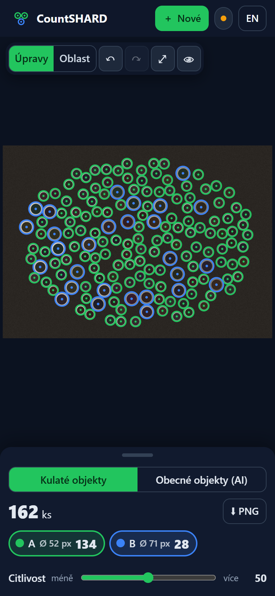
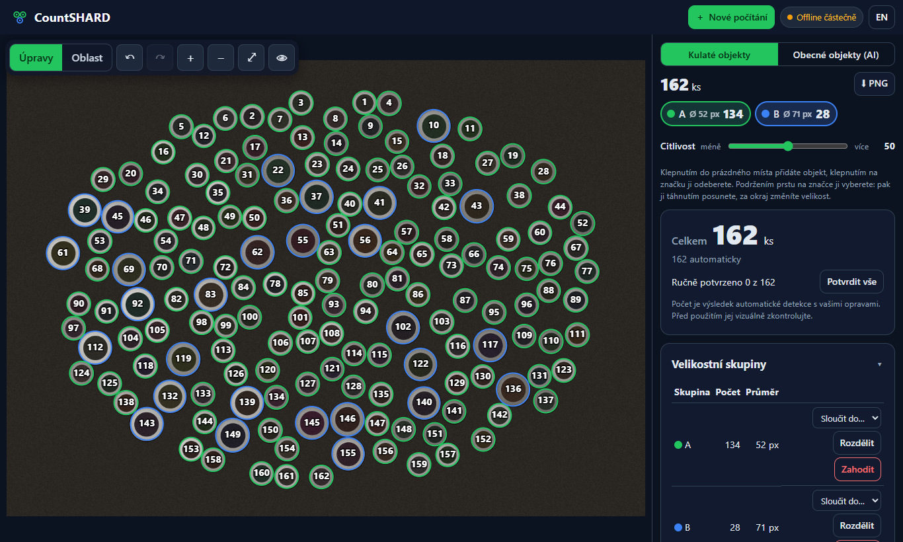

# CountSHARD

**Offline počítání objektů na fotografii – trubky a tyče z čela i jakékoli jiné kusy.**
Vyfoťte svazek z čela nebo cokoli jiného, aplikace objekty spočítá, rozdělí do skupin a vy chyby
opravíte klepnutím. Vše běží v prohlížeči – fotografie zařízení neopouštějí.

*Offline-first PWA that counts pipes and rods seen end-on or any other objects,
groups them by size and lets you correct the result. Everything runs locally in
the browser.*

<p align="center">
  
  &nbsp;
  
</p>

*Ukázkový (syntetický) snímek: 162 trubek ve dvou velikostech, automaticky rozdělených do skupin.*

## Features (MVP)

- Photo from file, drag & drop or the phone camera; EXIF orientation handled.
- Automatic detection of circular ends in a Web Worker (OpenCV.js), with progress
  and cancel. Works for solid rods and tubes (measures the outer wall, not the bore)
  and for mixed sizes in one photo.
- Counting area: outline the part of the photo to count (both modes); everything
  outside is ignored – detections, AI density, exports – without deleting anything.
- Corrections: tap to add / tap to remove, select to move or resize, undo/redo,
  "hold for original" compare, zoom/pan/pinch. Re-running detection keeps every
  correction (removed false hits stay removed).
- Automatic size groups (no fixed number assumed), fixed-k mode, merge/split,
  manual reassignment, per-group counts and diameters; optional mm calibration from
  one object or a group's nominal size, with uncertainty warnings.
- Clear result breakdown: automatic / added / removed / manually confirmed.
- Export: numbered PNG with legend, CSV (Czech Excel friendly), JSON project
  (re-importable, fully editable). Projects are auto-saved locally (IndexedDB).
- Installable PWA with an honest offline status (shell cached / engine cached /
  engine running).
- Czech UI, English included.

- Multi-shot: fuse 2–5 photos of the same bundle taken from nearly the same spot;
  every object counts once and shows in how many photos it was seen.

- **Generic objects (AI), mode "Obecné objekty (AI)":** mark 1–3 example objects and a
  LOCA model running in the browser (WebGPU or WASM) estimates how many there are. The
  result is shown as a density heat map and a total labelled as an **estimate** — objects
  are not individually identified — and can be corrected region by region. The model
  (≈ 63 MB with its runtime) is downloaded only when first used, then works offline.
  **The LOCA weights are for non-commercial use only** (CC BY-NC 4.0 via SwAV) —
  see [THIRD_PARTY_NOTICES.md](THIRD_PARTY_NOTICES.md).
  A second model, **GeCo2**, finds individual items instead: each gets a numbered box that
  can be removed or added by a tap, like in round-object mode. The AI panel offers
  *Automaticky* (default: chosen per device from WebGPU, memory and a short speed test),
  *LOCA – rychlý odhad* and *GeCo2 – přesnější, jednotlivé kusy*. GeCo2 (≈ 80–90 MB) runs on
  the graphics card on computers (≈ 6 s per photo) and on the processor on phones (iPhone
  ≈ 16 s, Galaxy A34 ≈ 1 min); its files are in `public/models/geco2/` and are downloaded only
  when GeCo2 is first used.

- **Steel products, mode "Hutní mat." (default for new photos):** no examples needed — a trained
  YOLOv8n detector (model from [IvanFenster/PipesCounting](https://github.com/IvanFenster/PipesCounting),
  ≈ 12 MB, `public/models/profiles/`, downloaded on first use) finds the ends of round pipes,
  square tubes, U channels and L angles and puts each type in its own group (≈ 1 s per photo on a
  computer; large photos with small items are split into overlapping tiles). A new photo is
  counted at once; corrections work like in the other modes. The three modes (*Kulaté*,
  *Hutní mat.*, *Obecné*) keep their own results in one project.

Not yet: Live Scan, PDF reports — see [docs/roadmap.md](docs/roadmap.md).

## Run

Requires Node 20+.

```bash
npm install
```

```bash
npm run dev
```

```bash
npm test
```

Production build and local preview (service worker active only here):

```bash
npm run build
```

```bash
npx vite preview --port 4173
```

The `dist/` folder is static and can be served from any HTTPS host (service
workers require HTTPS or localhost). The app uses relative paths, so it also works
from a sub-directory. Include OpenCV's Apache-2.0 licence when deploying (see
[THIRD_PARTY_NOTICES.md](THIRD_PARTY_NOTICES.md)).

## Documentation

- [Reference investigation (LoreaTec, REA)](docs/research/loreatec-analysis.md)
- [Technical decisions & spec review](docs/technical-decisions.md)
- [Architecture](docs/architecture.md)
- [Testing & measured results](docs/testing.md)
- [Limitations](docs/limitations.md)
- [Roadmap](docs/roadmap.md)

## Accuracy

On the synthetic evaluation suite the detector reaches 0.95–1.00 precision and
0.92–1.00 recall on most scenes and recovers four mixed pipe sizes with 99 % class
accuracy; dense tiny objects and heavy noise are weaker. **It has not yet been
evaluated on real photographs** — see [docs/testing.md](docs/testing.md). Always
check the marked image before relying on a count.

## Deployment

Every push to `main` runs the tests, builds the app and publishes it to GitHub Pages
(`.github/workflows/pages.yml`). In the repository settings, *Pages → Source* must be
set to **GitHub Actions**. Pages serves over HTTPS, so the service worker and offline
mode work from the published link.

## Licence

Code: [MIT](LICENSE). Third-party components: see [THIRD_PARTY_NOTICES.md](THIRD_PARTY_NOTICES.md).
The AI model files in `public/models/loca/` are derived from non-commercially licensed
weights (CC BY-NC 4.0) and are **not** covered by the MIT licence. The GeCo2 model files
in `public/models/geco2/` are not covered by it either; their weights' licence is not
stated by their authors.
